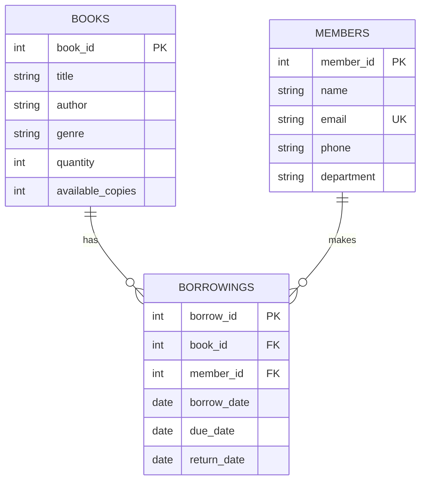

# Library Management System using DBMS (Frontend without Python)

A full-featured, responsive, interactive Web Frontend and Relational DBMS interface for a Library Management System built **strictly without Python**.

---

## 🌟 Key Features

1. **Zero-Python Stack**:
   - Built with **HTML5, Tailwind CSS, JavaScript (ES6+), and Chart.js**.
   - Runs directly in **any modern web browser** (Chrome, Edge, Firefox, Safari) by opening `index.html`, OR via a lightweight, zero-dependency Node.js HTTP server.
2. **Interactive In-Browser Relational DBMS Engine**:
   - Executes standard SQL statements (`SELECT`, `JOIN`, `WHERE`, `GROUP BY`, `HAVING`, `ORDER BY`, `UNION ALL`, `INSERT`, `UPDATE`, `DELETE`, and Subqueries).
   - Pre-populated with the exact 10 Books, 10 Members, and 15 Borrowing records specified in the schema.
   - Enforces relational constraints: Foreign Keys, Unique email constraint, Non-negative quantities (`quantity >= 0`), and Availability checks (`available_copies <= quantity`).
3. **Live SQL Lab & Query Console**:
   - Includes one-click execution for all **8+ practice queries**, including:
     - Grouping & `HAVING` filters (`HAVING COUNT(*) >= 2`)
     - Multi-table `INNER JOIN` (Books + Members + Borrowings)
     - Overdue books detection (`due_date < CURRENT_DATE`)
     - Scalar subquery (`WHERE quantity > (SELECT AVG(quantity) FROM books)`)
     - Table count union (`UNION ALL`)
   - Interactive SQL editor where you can write and execute any custom SQL statement in real-time with tabular output and execution metrics.
4. **GUI CRUD & Transaction-Safe Operations**:
   - **Books Catalog**: Search, filter by genre, sort by stock, Add/Edit/Delete books.
   - **Members Directory**: Contact info, department filter, active loans count, Add/Edit/Delete members.
   - **Issue Book Flow**: Automatically decrements available copies in `Books` and inserts the loan into `Borrowings`.
   - **Return Book Flow**: Automatically increments available stock and timestamps the return.
   - **Live SQL Action Feedback**: Whenever you perform any UI action (such as issuing or returning a book), a toast shows the exact SQL statement executed behind the scenes.
5. **Simulated Date Controller**:
   - Test overdue calculations by changing the system date in the top bar (e.g., from `2026-10-22` to `2026-10-30`) to dynamically observe books become overdue in real-time.

---

## 📁 Project Directory Structure

```text
library-management-system/
├── index.html              # Main single-page application interface
├── css/
│   └── styles.css          # Custom styling, badges, glassmorphism, table layout
├── js/
│   ├── db.js               # Relational DBMS engine, schema, constraints, SQL parser
│   ├── queries.js          # Pre-configured practice queries with DBMS explanations
│   └── app.js              # UI controller, event handlers, Chart.js rendering
├── server.js               # Zero-dependency Node.js HTTP server (optional)
├── start.bat               # Windows 1-click launcher
├── schema_and_seed.sql     # Full SQL file for PostgreSQL/MySQL/SQLite
└── README.md               # Project guide and Viva prep
```

---

## 🚀 How to Run the Frontend (Without Python)

You have **two simple options** to run this project:

### Option A: Direct Browser Launch (Easiest & Zero Setup)
1. Navigate to the project directory:
   `C:\Users\gargi\.gemini\antigravity\scratch\library-management-system`
2. Simply double-click **`index.html`** or right-click and choose **Open with > Google Chrome / Microsoft Edge**.
3. That's it! Everything works immediately offline with local storage persistence.

---

### Option B: Local Web Server (Using Node.js)
If you want to run it via an HTTP server (`http://localhost:3000`):

1. Double-click **`start.bat`** (on Windows), **OR**
2. Open terminal in the project folder and run:
   ```powershell
   node server.js
   ```
3. Open your browser and navigate to:
   ```text
   http://localhost:3000
   ```
*(Note: `server.js` uses only built-in Node.js standard modules—no `npm install` required).*

---

## 🗄️ Database Schema & Relational Model



### Table 1: `Books`
| Column | Type | Constraints | Description |
| :--- | :--- | :--- | :--- |
| `book_id` | INT | PRIMARY KEY, AUTO_INCREMENT | Unique book identifier |
| `title` | VARCHAR(100) | NOT NULL | Title of the book |
| `author` | VARCHAR(100) | NOT NULL | Book author |
| `genre` | VARCHAR(50) | NULLABLE | Category (Fiction, Technology, etc.) |
| `quantity` | INT | NOT NULL, CHECK (>= 0) | Total copies owned by library |
| `available_copies` | INT | NOT NULL, CHECK (>= 0 AND <= quantity) | Current copies on shelf |

### Table 2: `Members`
| Column | Type | Constraints | Description |
| :--- | :--- | :--- | :--- |
| `member_id` | INT | PRIMARY KEY, AUTO_INCREMENT | Unique member identifier |
| `name` | VARCHAR(100) | NOT NULL | Full name of member |
| `email` | VARCHAR(100) | NOT NULL, UNIQUE | Member email address |
| `phone` | VARCHAR(15) | NULLABLE | Contact telephone |
| `department` | VARCHAR(50) | NULLABLE | College department |

### Table 3: `Borrowings`
| Column | Type | Constraints | Description |
| :--- | :--- | :--- | :--- |
| `borrow_id` | INT | PRIMARY KEY, AUTO_INCREMENT | Unique loan transaction ID |
| `book_id` | INT | FOREIGN KEY REFERENCES Books | Borrowed book reference |
| `member_id` | INT | FOREIGN KEY REFERENCES Members | Borrower reference |
| `borrow_date` | DATE | NOT NULL, DEFAULT CURRENT_DATE | Issue date |
| `due_date` | DATE | NOT NULL, CHECK (due_date >= borrow_date) | Expected return date |
| `return_date` | DATE | NULLABLE, CHECK (return_date >= borrow_date) | Actual return date |

---

## 🔍 Pre-Built Practice Queries (Available in the "SQL Lab" Tab)

1. **Display All Books**:
   ```sql
   SELECT * FROM books;
   ```
2. **Search for Genre**:
   ```sql
   SELECT title, author, genre FROM books WHERE genre = 'Fiction';
   ```
3. **Sort Books Alphabetically**:
   ```sql
   SELECT title, author, quantity FROM books ORDER BY title ASC;
   ```
4. **Count Books by Genre (GROUP BY)**:
   ```sql
   SELECT genre, COUNT(*) AS total_books FROM books GROUP BY genre ORDER BY total_books DESC;
   ```
5. **Genres with at least 2 Books (HAVING)**:
   ```sql
   SELECT genre, COUNT(*) AS total_books FROM books GROUP BY genre HAVING COUNT(*) >= 2;
   ```
6. **Relational Multi-Table Join**:
   ```sql
   SELECT b.title, m.name AS member_name, br.borrow_date, br.due_date, br.return_date
   FROM borrowings br
   JOIN books b ON br.book_id = b.book_id
   JOIN members m ON br.member_id = m.member_id;
   ```
7. **Overdue Books Audit Report**:
   ```sql
   SELECT b.title, m.name AS member_name, m.email, br.due_date
   FROM borrowings br
   JOIN books b ON br.book_id = b.book_id
   JOIN members m ON br.member_id = m.member_id
   WHERE br.return_date IS NULL
     AND br.due_date < CURRENT_DATE
   ORDER BY br.due_date;
   ```
8. **Average Quantity & Subquery**:
   ```sql
   -- 8.1 Average quantity
   SELECT AVG(quantity) AS average_quantity FROM books;

   -- 8.2 Subquery for above average stock
   SELECT title, quantity FROM books WHERE quantity > (SELECT AVG(quantity) FROM books);
   ```
9. **Check All Tables Record Counts (`UNION ALL`)**:
   ```sql
   SELECT 'Books' AS table_name, COUNT(*) AS total_records FROM books
   UNION ALL
   SELECT 'Members', COUNT(*) FROM members
   UNION ALL
   SELECT 'Borrowings', COUNT(*) FROM borrowings;
   ```

---

## 🎓 Viva & Exam Questions (DBMS Core Concepts)

1. **Q: Why use `HAVING` instead of `WHERE` for aggregate counts?**
   - **A:** `WHERE` filters individual rows **before** aggregation and grouping occur. `HAVING` filters the grouped summary rows **after** `GROUP BY` has evaluated aggregate functions (like `COUNT(*)`).
2. **Q: How does the system handle book stock integrity when issuing books?**
   - **A:** A database transaction is executed:
     1. Inserts loan into `Borrowings`.
     2. Decrements `available_copies` in `Books` by 1.
     3. Checks `available_copies >= 0`. If copies are 0, the operation is blocked.
3. **Q: What is the purpose of `information_schema.tables`?**
   - **A:** `information_schema` is the ANSI-standard set of read-only metadata views providing table catalogs, column data types, constraints, and index details across the database.
