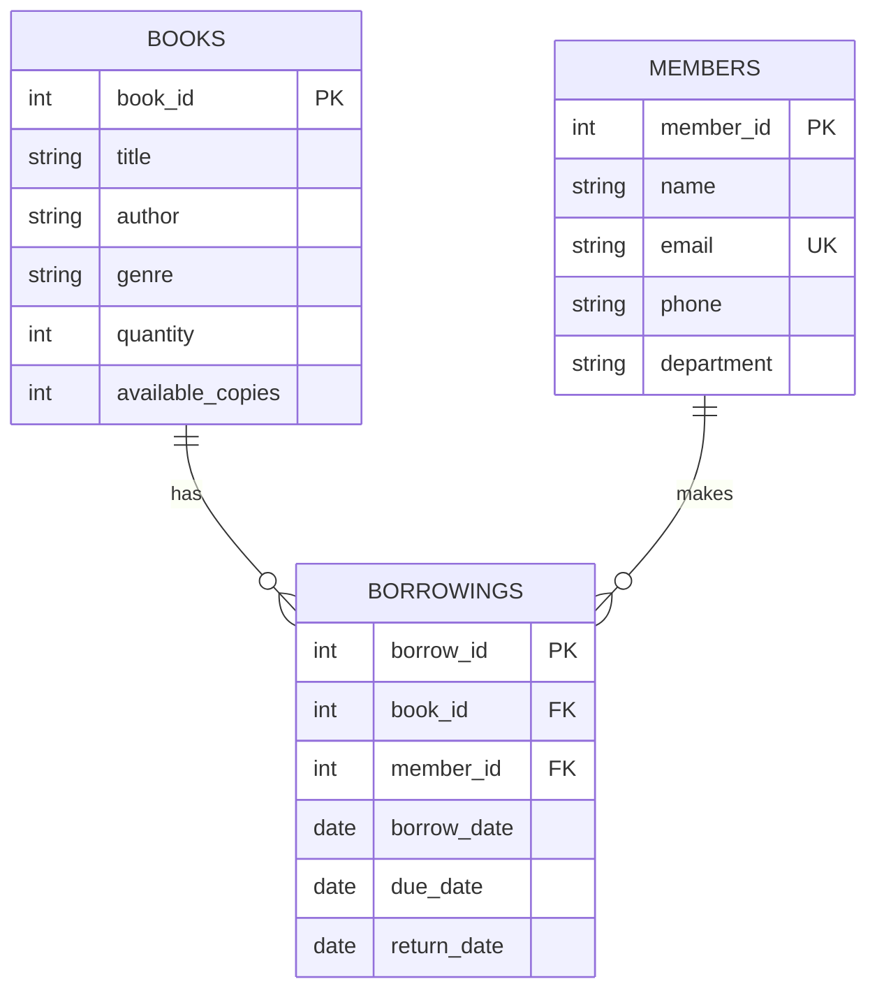

# Library Management System using DBMS


A full-featured, responsive, interactive Web Frontend and Relational Database Management System interface for a Library Management System built **strictly without Python**.

---

## 📊 Project Status & Implementation Checklist

| Component / Requirement | Status | Verification & Notes |
| :--- | :---: | :--- |
| **Database Creation** | ✅ Completed | `library_management` database created on PostgreSQL 18.6 |
| **Table 1: Books** | ✅ Completed | Schema verified; PK (`IDENTITY`), `CHECK (quantity >= 0)`, `CHECK (available_copies <= quantity)` |
| **Table 2: Members** | ✅ Completed | Schema verified; PK (`IDENTITY`), `email UNIQUE`, contact and department fields |
| **Table 3: Borrowings** | ✅ Completed | Schema verified; PK, FK &rarr; `Books`, FK &rarr; `Members`, check constraint on due & return dates |
| **Data Population** | ✅ Completed | 10 Books, 10 Members, and 15 Borrowing records (5 active, 10 returned) |
| **Live Database Connection** | ✅ Completed | Real-time bidirectional connection to local PostgreSQL port 5432 via Node.js bridge |
| **Interactive Frontend** | ✅ Completed | Single-Page Application (SPA) using HTML5, Tailwind CSS, Vanilla JS, and Chart.js |
| **GUI CRUD Operations** | ✅ Completed | Add, update, delete books & members; Issue and Return book workflows |
| **Overdue Audit Report** | ✅ Completed | Dynamic overdue calculation with simulated date picker and one-click reminders |
| **Interactive SQL Console** | ✅ Completed | In-browser SQL execution lab with formatted results table and millisecond execution metrics |
| **Practice Queries (1 - 8.2)** | ✅ Completed | All 8+ queries tested and verified against live PostgreSQL engine |

---

## 🌟 Key Features

1. **Modern Responsive Web Interface & Dashboard**:
   - Built with **HTML5, Tailwind CSS, JavaScript (ES6+), and Chart.js** for interactive analytics and dynamic catalog management.
   - Runs directly in **any modern web browser** (Chrome, Edge, Firefox, Safari) by opening `index.html`, or via a lightweight Node.js HTTP server.
2. **Dual Database Engine (Live PostgreSQL + In-Memory Fallback)**:
   - Connects live to **PostgreSQL 18** on `localhost:5432` for authentic relational database persistence.
   - Includes a standalone in-browser relational execution engine so it can also function offline without any running services.
   - Enforces relational constraints: Foreign Keys, Unique email constraint, non-negative quantities (`quantity >= 0`), and availability checks (`available_copies <= quantity`).
3. **Live SQL Lab & Practice Console**:
   - Includes one-click execution for all **8+ practice queries**, including:
     - Grouping & `HAVING` filters (`HAVING COUNT(*) >= 2`)
     - Multi-table `INNER JOIN` (`Borrowings` + `Books` + `Members`)
     - Overdue books detection (`due_date < CURRENT_DATE`)
     - Scalar subquery (`WHERE quantity > (SELECT AVG(quantity) FROM books)`)
     - Table count union (`UNION ALL`)
   - Interactive SQL editor where you can write and execute any custom SQL statement in real-time with tabular output and execution metrics.
4. **Transaction-Safe GUI Operations**:
   - **Books Catalog**: Search, filter by genre, sort by stock, Add/Edit/Delete books.
   - **Members Directory**: Contact info, department filter, active loans count, Add/Edit/Delete members.
   - **Issue Book Flow**: Automatically decrements available copies in `Books` and inserts the loan into `Borrowings`.
   - **Return Book Flow**: Automatically increments available stock and timestamps the return.
   - **Live SQL Feedback Toasts**: Whenever you perform any UI action (such as issuing or returning a book), a toast shows the exact SQL statement executed behind the scenes.
5. **Simulated Date Controller**:
   - Test overdue calculations by changing the system date in the top bar (e.g., from `2026-10-22` to `2026-10-30`) to dynamically observe books become overdue in real-time.

---

## 📁 Project Directory Structure

```text
library-management-system/
├── index.html              # Main single-page application interface
├── css/
│   └── styles.css          # Custom styling, badges, glassmorphism, table layout
├── js/
│   ├── db.js               # Relational DBMS engine, schema, constraints, SQL parser
│   ├── queries.js          # Pre-configured practice queries with DBMS explanations
│   └── app.js              # UI controller, event handlers, Chart.js rendering
├── server.js               # Node.js HTTP server & live PostgreSQL 18 bridge
├── start.bat               # Windows 1-click launcher
├── setup_postgres.bat      # PostgreSQL automated DDL setup script
├── schema_and_seed.sql     # Full SQL file for PostgreSQL/MySQL/SQLite
├── db_config.example.json  # Safe configuration template
└── README.md               # Project guide, status checklist, and query reference
```

---

## 🚀 How to Run the Frontend

You have **two simple options** to run this project:

### Option A: Local Web Server with PostgreSQL Bridge (Recommended)
1. In the project folder, double-click **`start.bat`** (or run `node server.js`).
2. Open your browser and navigate to:
   ```text
   http://localhost:3000
   ```
3. The server connects automatically to your local PostgreSQL instance on port `5432`.

---

### Option B: Direct Browser Launch (Offline Mode)
1. Double-click **`index.html`** in any web browser.
2. The system operates seamlessly using the built-in client-side relational database engine with local storage persistence.

---

## 🗄️ Database Schema & Relational Model



### Table 1: `Books`
| Column | Type | Constraints | Description |
| :--- | :--- | :--- | :--- |
| `book_id` | INT | PRIMARY KEY, IDENTITY | Unique book identifier |
| `title` | VARCHAR(100) | NOT NULL | Title of the book |
| `author` | VARCHAR(100) | NOT NULL | Book author |
| `genre` | VARCHAR(50) | NULLABLE | Category (Fiction, Technology, etc.) |
| `quantity` | INT | NOT NULL, CHECK (>= 0) | Total copies owned by library |
| `available_copies` | INT | NOT NULL, CHECK (>= 0 AND <= quantity) | Current copies on shelf |

### Table 2: `Members`
| Column | Type | Constraints | Description |
| :--- | :--- | :--- | :--- |
| `member_id` | INT | PRIMARY KEY, IDENTITY | Unique member identifier |
| `name` | VARCHAR(100) | NOT NULL | Full name of member |
| `email` | VARCHAR(100) | NOT NULL, UNIQUE | Member email address |
| `phone` | VARCHAR(15) | NULLABLE | Contact telephone |
| `department` | VARCHAR(50) | NULLABLE | College department |

### Table 3: `Borrowings`
| Column | Type | Constraints | Description |
| :--- | :--- | :--- | :--- |
| `borrow_id` | INT | PRIMARY KEY, IDENTITY | Unique loan transaction ID |
| `book_id` | INT | FOREIGN KEY REFERENCES Books | Borrowed book reference |
| `member_id` | INT | FOREIGN KEY REFERENCES Members | Borrower reference |
| `borrow_date` | DATE | NOT NULL, DEFAULT CURRENT_DATE | Issue date |
| `due_date` | DATE | NOT NULL, CHECK (due_date >= borrow_date) | Expected return date |
| `return_date` | DATE | NULLABLE, CHECK (return_date >= borrow_date) | Actual return date |

---

## 🔍 Pre-Built Practice Queries (Available in the "SQL Lab" Tab)

1. **Display All Books**:
   ```sql
   SELECT * FROM books;
   ```
2. **Search for Genre**:
   ```sql
   SELECT title, author, genre FROM books WHERE genre = 'Fiction';
   ```
3. **Sort Books Alphabetically**:
   ```sql
   SELECT title, author, quantity FROM books ORDER BY title ASC;
   ```
4. **Count Books by Genre (GROUP BY)**:
   ```sql
   SELECT genre, COUNT(*) AS total_books FROM books GROUP BY genre ORDER BY total_books DESC;
   ```
5. **Genres with at least 2 Books (HAVING)**:
   ```sql
   SELECT genre, COUNT(*) AS total_books FROM books GROUP BY genre HAVING COUNT(*) >= 2;
   ```
6. **Relational Multi-Table Join**:
   ```sql
   SELECT b.title, m.name AS member_name, br.borrow_date, br.due_date, br.return_date
   FROM borrowings br
   JOIN books b ON br.book_id = b.book_id
   JOIN members m ON br.member_id = m.member_id;
   ```
7. **Overdue Books Audit Report**:
   ```sql
   SELECT b.title, m.name AS member_name, m.email, br.due_date
   FROM borrowings br
   JOIN books b ON br.book_id = b.book_id
   JOIN members m ON br.member_id = m.member_id
   WHERE br.return_date IS NULL
     AND br.due_date < CURRENT_DATE
   ORDER BY br.due_date;
   ```
8. **Average Quantity & Subquery**:
   ```sql
   -- 8.1 Average quantity
   SELECT AVG(quantity) AS average_quantity FROM books;

   -- 8.2 Subquery for above average stock
   SELECT title, quantity FROM books WHERE quantity > (SELECT AVG(quantity) FROM books);
   ```
9. **Check All Tables Record Counts (`UNION ALL`)**:
   ```sql
   SELECT 'Books' AS table_name, COUNT(*) AS total_records FROM books
   UNION ALL
   SELECT 'Members', COUNT(*) FROM members
   UNION ALL
   SELECT 'Borrowings', COUNT(*) FROM borrowings;
   ```
